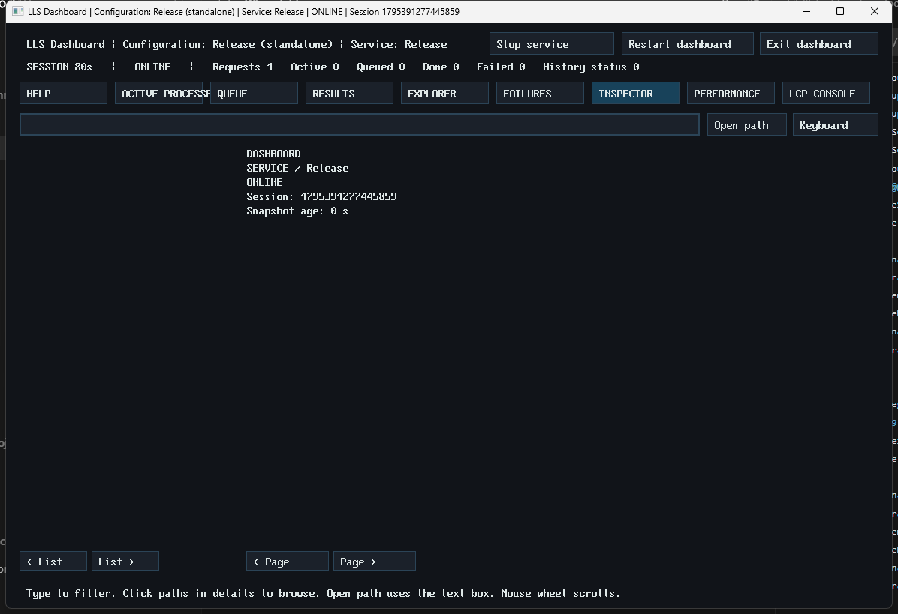
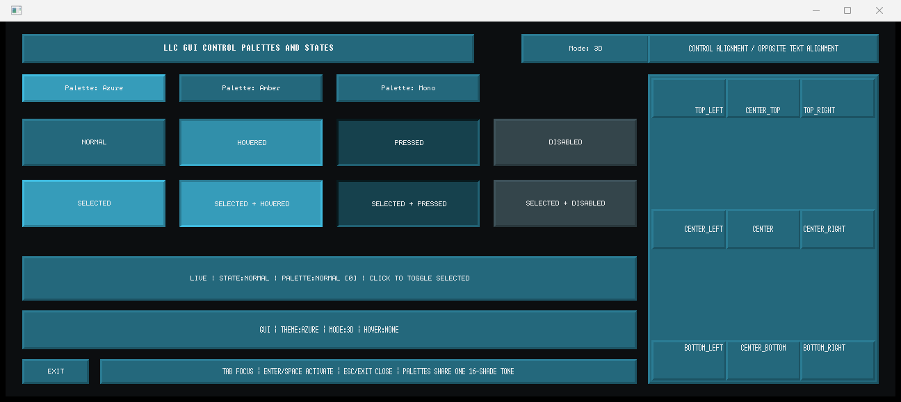
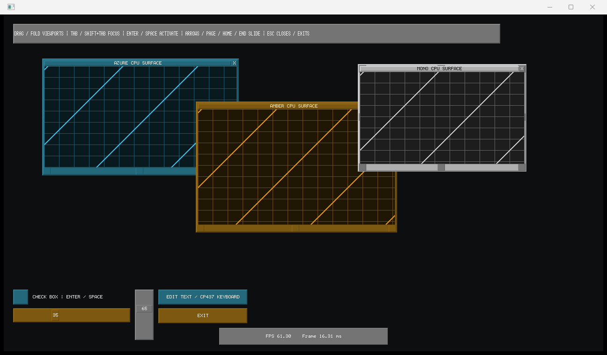
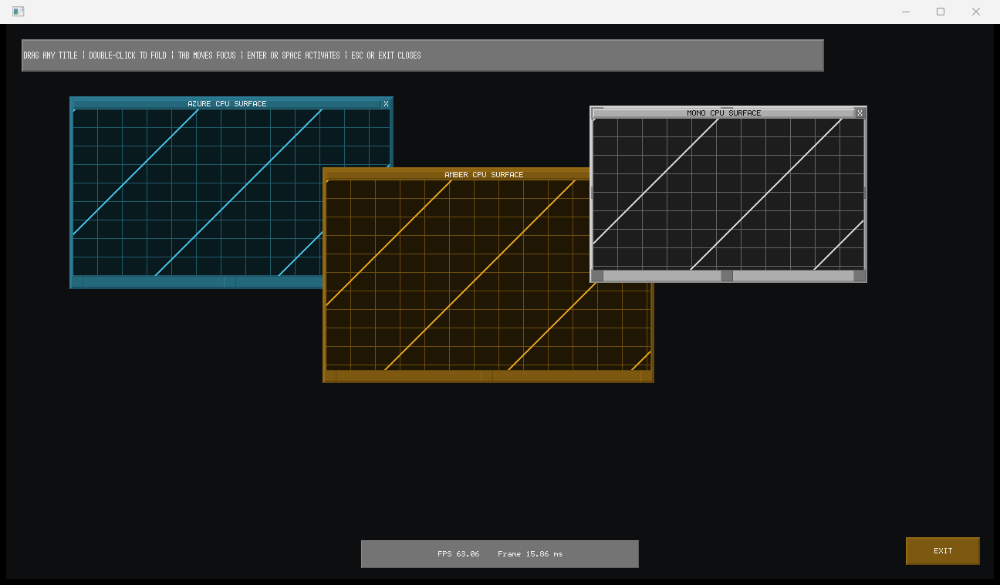
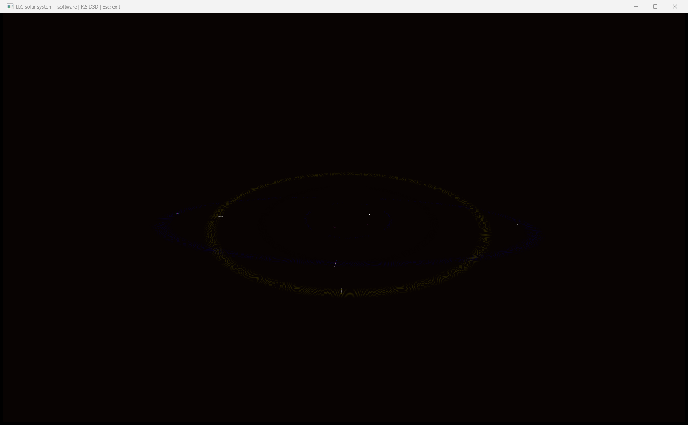
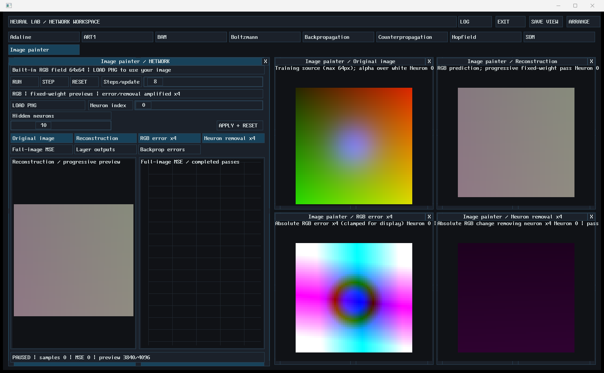
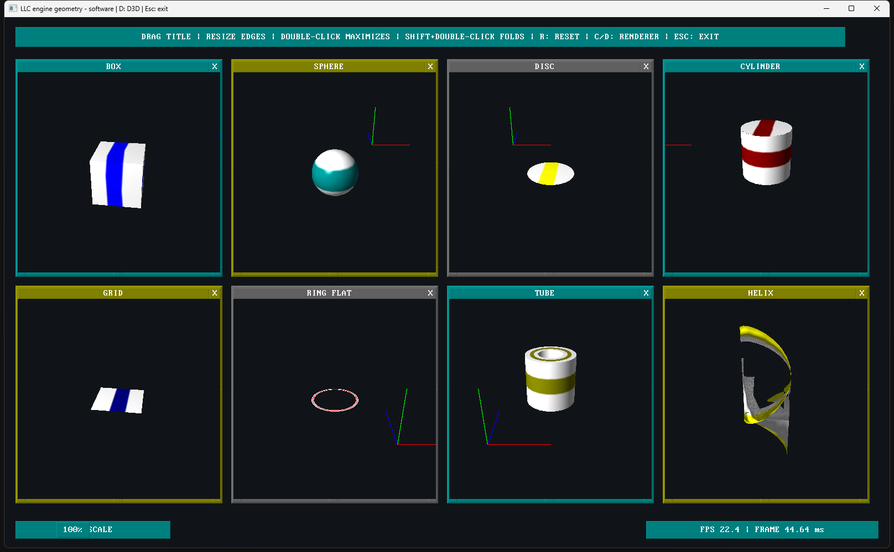

# Conduit Windows baseline

The `llb_conduit` branch pins the matching `llb_conduit` heads of LLC, LLT, LLC data, LLC Samples, and Samples data. Its `.gitmodules` file declares those branches. The retired zlib and `llc_engine` submodule entries are absent; `llc_engine` is built from the LLC repository.

All 27 `.vcxproj` files use `<AdditionalLibraryDirectories>$(OutDir);</AdditionalLibraryDirectories>` in each Link group. Their `.lib` inputs are bare filenames, with no hard `ProjectReference` elements. The solutions order internal library producers before their consumers. Every declared platform has `Debug-MT` and `Release-MT` project configurations, and the LLT solution no longer maps MT builds to plain Debug or Release output folders.

The full LLC, LLT, and LLC Samples solutions passed Release x64 builds after the library-path edits. LLC Release-MT x64 also passed after the MT configuration edits. The other MT solution builds were still in progress when this evidence was recorded.

## LLS ONLINE proof

From this checkout's `x64.Release` output, `lls.exe` was started and remained running. A separate `lcp.exe --service=Release` client sent a `help` request through the service and received [`resultType: complete`, `isError: false`](lls_release_probe.json). The Release dashboard connected to that service and displayed **ONLINE** in its title and status area:

The dashboard showed one request and `Done 0`; this image proves connection and the separate connector response proves that request completed. It does not claim a completed queued job or interactive dashboard testing.

## Graphical startup captures

These captures show built Release x64 applications opening and rendering. They are startup views, not interaction tests.

